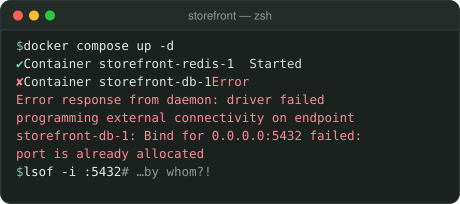
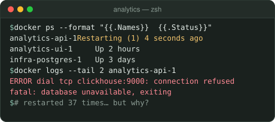
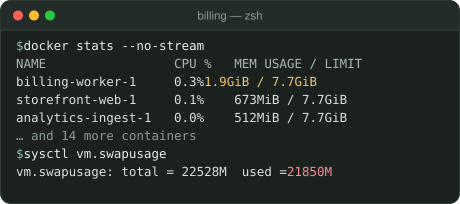
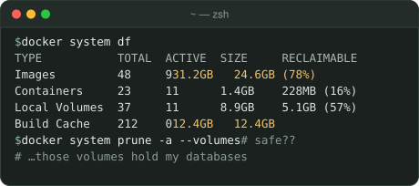
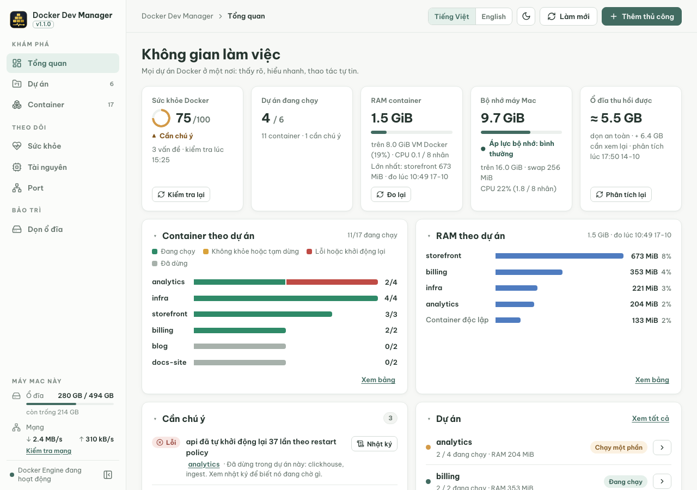

# Docker Dev Manager

[English](README.md) · **Tiếng Việt**

**Mọi dự án Docker Compose trên máy bạn, gọn trong một dashboard.**

Làm việc với Docker Compose đủ lâu, chắc bạn đã gặp ít nhất một cảnh thế này:

<table>
<tr>
<td width="50%"><br><b>"Port is already allocated"</b>: ai đang giữ port 5432?</td>
<td width="50%"><br><b>Container khởi động lại liên tục</b>, còn lý do thì chìm trong log.</td>
</tr>
<tr>
<td width="50%"><br><b>Máy ì ạch, swap đầy</b>: dự án nào đang ngốn RAM?</td>
<td width="50%"><br><b>Docker ngốn hơn 50 GB ổ đĩa</b>: xóa gì mới an toàn?</td>
</tr>
</table>

**Docker Dev Manager gom tất cả về một màn hình.** Nó tự tìm mọi dự án, cho bạn thấy ngay cái gì đang chạy, cái gì đang lỗi, cái gì đang ngốn RAM và ổ đĩa, rồi để bạn xử lý bằng một cú bấm. Không import, không đụng tới file nào của dự án.



## Bắt đầu trong một phút

Bạn cần:

- **Node.js 20 trở lên**
- **Docker Desktop**, hoặc Docker Engine kèm plugin `docker compose` v2, đang chạy
- **macOS, Windows hoặc Linux**. Mọi thứ chạy được trên cả ba, trừ: các nút Terminal, hộp chọn thư mục và việc mở Finder/File Explorer, Terminal, VS Code chỉ có trên macOS và Windows; áp lực bộ nhớ và swap trên thẻ bộ nhớ chỉ có trên macOS.

**1. Tải mã nguồn**

```bash
git clone https://github.com/atdevblog/docker-dev-manager.git
cd docker-dev-manager
```

**2. Chạy dashboard**

```bash
npm start
```

Không cần cài gì trước: dự án không có dependency nào.

**3. Mở http://localhost:4173**

Các dự án của bạn tự hiện ra. Bấm `Ctrl+C` trong terminal để tắt dashboard.

Cần port khác? Chạy `DEV_MANAGER_PORT=4174 npm start` (PowerShell: `$env:DEV_MANAGER_PORT=4174; npm start`). Muốn dashboard vẫn chạy sau khi đóng terminal, dùng trình quản lý tiến trình quen thuộc của bạn, hoặc trên macOS và Linux `nohup npm start >/tmp/docker-dev-manager.log 2>&1 &`.

<details>
<summary>Tất cả tùy chọn</summary>

| Biến môi trường | Mặc định | Công dụng |
|---|---|---|
| `DEV_MANAGER_PORT` | `4173` | Port của dashboard (luôn chỉ bind `127.0.0.1`) |
| `DEV_MANAGER_CONFIG_DIR` | `~/.config/docker-dev-manager` | Nơi lưu cài đặt và kết quả đo gần nhất |
| `DEV_MANAGER_IDLE_MINUTES` | `15` | Khoảng cách tối thiểu giữa hai lần đo RAM/CPU để một dự án im lặng (không traffic mạng, CPU < 1%) được coi là nhàn rỗi |

</details>

## Khám phá hướng dẫn sử dụng

**[Hướng dẫn sử dụng](docs/guide.vi.md)** đi qua từng màn hình, từng bước một:

| Bắt đầu | Dùng hằng ngày | Giữ máy khỏe |
|---|---|---|
| [Cài đặt và mở](docs/guide.vi.md#1-cài-đặt-và-mở) | [Khởi động, dừng, khởi động lại](docs/guide.vi.md#4-khởi-động-dừng-khởi-động-lại) | [Sức khỏe & tư vấn tài nguyên](docs/guide.vi.md#3-sức-khỏe--tư-vấn-tài-nguyên) |
| [Tổng quan màn hình](docs/guide.vi.md#2-tổng-quan-màn-hình) | [Điều khiển từng container](docs/guide.vi.md#điều-khiển-từng-container) | [Giải phóng bộ nhớ](docs/guide.vi.md#8-giải-phóng-bộ-nhớ) |
| [Import dự án, Up và Down](docs/guide.vi.md#11-import-dự-án-up-và-down) | [Vì sao dự án không chạy?](docs/guide.vi.md#5-vì-sao-dự-án-không-chạy) | [Chọn port trống](docs/guide.vi.md#9-chọn-port-trống) |
| [Ngôn ngữ](docs/guide.vi.md#12-ngôn-ngữ) | [Xem nhật ký](docs/guide.vi.md#6-xem-nhật-ký) | [Dọn ổ đĩa an toàn](docs/guide.vi.md#10-dọn-ổ-đĩa-an-toàn) |
| [Câu hỏi và sự cố thường gặp](docs/guide.vi.md#13-câu-hỏi-và-sự-cố-thường-gặp) | [Nhóm từ Docker](docs/guide.vi.md#7-nhóm-từ-docker) | |

## Bên trong có gì

| | |
|---|---|
| 📊 **Tổng quan trong một màn hình** | Sức khỏe Docker, dự án đang chạy, RAM container, bộ nhớ của máy và ổ đĩa thu hồi được trên một hàng, cùng biểu đồ container theo trạng thái và RAM theo dự án. Sidebar luôn hiện dung lượng ổ đĩa và lưu lượng mạng, kèm nút kiểm tra mạng xếp loại Nhanh, Ổn hay Chậm. |
| 🔌 **Port** | Port nào trên máy đang bị ai giữ, port nào dự án đã dừng sẽ cần lại, và port trống gần nhất. |
| 🔁 **Vì sao không chạy** | Crash loop, mã thoát giải thích dễ hiểu, bị kill vì hết bộ nhớ, lỗi khởi động, mỗi dòng chỉ cách đúng nhật ký một cú bấm, lọc riêng dòng lỗi nếu muốn. |
| 🧠 **Giải phóng bộ nhớ** | Dự án xếp theo RAM so với giới hạn của Docker VM, phát hiện dự án nhàn rỗi qua hai lần đo, và luôn có bước xem lại những gì sẽ bị ảnh hưởng trước khi dừng. |
| 💾 **Dọn ổ đĩa** | Dung lượng Docker đang dùng, chia thành *dọn an toàn*, *cần xem lại* và *có thể chứa dữ liệu*, kèm lệnh để sao chép. Dashboard không bao giờ tự xóa gì. |
| 🎛️ **Điều khiển ở mọi cấp** | Khởi động, dừng, khởi động lại cả dự án, cả nhóm dự án dùng chung network (đúng thứ tự phụ thuộc) hoặc từng container, giống Docker Desktop. Mở shell vào bên trong container, hoặc Terminal ngay tại thư mục của nó. |
| 🩺 **Tư vấn sức khỏe** | Điểm sức khỏe chỉ gồm các khoản trừ có giải thích, cùng danh sách việc cần làm xếp từ **Khẩn cấp → Tối ưu**, mỗi việc ghi rõ giải phóng bao nhiêu RAM hay ổ đĩa và mức rủi ro. |

## Làm ra để dùng mỗi ngày

- ⚡ **Không đăng ký, không đám mây:** không database, không tài khoản. Chỉ một tiến trình Node trên máy bạn, dữ liệu không rời khỏi máy.
- 🖥️ **Chạy ở nơi bạn làm việc:** macOS, Windows và Linux.
- 🛡️ **An toàn mặc định:** mọi thao tác đều được kiểm tra trước. Port bị chiếm sẽ chặn lệnh khởi động, và những gì phụ thuộc vào thứ bạn sắp dừng đều được chỉ ra. Không có gì bị dừng hay xóa tự động.
- 🪶 **Nhẹ mặc định:** khoảng 15 MB RAM và không tốn CPU khi để yên. Những phép đo tốn vài giây của Docker chỉ chạy khi bạn bấm nút của nó.
- 🌗 **Dễ chịu khi nhìn lâu:** giao diện sáng và tối, Tiếng Việt và English. Lựa chọn của bạn và kết quả đo gần nhất vẫn còn sau khi reload.

Công cụ bổ trợ cho Docker Desktop chứ không thay thế nó.

## Bảo mật

Đây là **công cụ cục bộ cho một người dùng**. Nó chỉ lắng nghe ở `127.0.0.1`, từ chối request có `Host` không phải `localhost`, và yêu cầu token theo phiên cùng `Origin` localhost cho mọi thay đổi. Lệnh chạy bằng quyền Docker của chính bạn. Kết nối duy nhất ra Internet là nút kiểm tra mạng ở sidebar, và chỉ khi bạn bấm: nó mở rồi đóng một kết nối tới `registry-1.docker.io` và `1.1.1.1` để đo thời gian; không gửi hay tải dữ liệu nào. Không mở công cụ ra mạng hay qua tunnel.

<details>
<summary>Tùy chọn: mở bằng tên miền cục bộ qua reverse proxy</summary>

Proxy chạy trên cùng máy và chính nó chỉ bind `127.0.0.1` sẽ dùng được, nếu đổi `Host` và `Origin` về localhost. Ví dụ với nginx:

```nginx
map $http_origin $ddm_origin { default $http_origin; "~^https?://docker-dev\.localhost$" "http://localhost:4173"; }
server {
    listen 127.0.0.1:80;
    server_name docker-dev.localhost;
    location / {
        proxy_pass http://127.0.0.1:4173;
        proxy_set_header Host localhost:4173;
        proxy_set_header Origin $ddm_origin;
        proxy_read_timeout 180s;
    }
}
```
</details>

<details>
<summary>File cài đặt</summary>

Cài đặt được lưu ở `~/.config/docker-dev-manager/projects.json` (trên Windows là `%USERPROFILE%\.config\docker-dev-manager\projects.json`). File chỉ được tạo khi bạn lưu một thứ gì đó: dự án đã import, *luôn chạy*, ngôn ngữ hoặc giao diện sáng/tối.

```json
{
  "projects":    [{"name": "billing", "directory": "/Users/you/Projects/billing", "composeFile": "compose.yaml", "description": "Payments service"}],
  "keepRunning": ["infra"],
  "language":    "vi",
  "theme":       "dark"
}
```

File được ghi atomic với quyền `0600`, giữ nguyên các key khác. File bị hỏng không bao giờ bị ghi đè. Kết quả đo gần nhất (kiểm tra sức khỏe, `docker stats`, `docker system df -v`) được lưu cạnh đó trong `measurements.json`: sau khi reload chúng hiện lại kèm giờ đo, kết quả cũ hơn 7 ngày bị bỏ qua, và bạn có thể xóa file này bất cứ lúc nào.
</details>

## Phát triển

<details>
<summary>Cấu trúc dự án, test và cách thao tác chạy</summary>

```
server.js            HTTP server, gọi Docker CLI, kiểm tra trước, tác vụ nền, lưu kết quả đo
lib/analysis.js      luật thuần: gom nhóm, vấn đề, phụ thuộc, port, tài nguyên, ổ đĩa, kiểm tra trước cho container
lib/advisor.js       điểm sức khỏe, lãng phí và khuyến nghị xếp theo thứ tự
lib/platform.js      phần khác nhau theo hệ điều hành: terminal, hộp chọn thư mục, Finder/File Explorer, đường dẫn, lệnh sao chép
public/              trang web (index.html, app.js, style.css), i18n.js, locales/, icon, fonts/
assets/icons/        file nguồn icon; build.sh tạo lại favicon.ico và apple-touch-icon.png
docs/                hướng dẫn sử dụng (en, vi) và ảnh chụp
test/                các bộ test node:test
```

- `npm test` chạy unit test, HTTP test và test bản dịch. Không thay đổi trạng thái Docker và dùng thư mục cài đặt tạm. GitHub Actions chạy nó trên macOS, Windows và Ubuntu cho mỗi lần push và pull request.
- `npm run test:docker` là test tùy chọn trên Docker Engine thật. Nó tạo các dự án tạm `ddmit*` (image `nginx:alpine`, port 47391) rồi xóa sau khi xong.
- **Chữ và ngôn ngữ:** mọi chuỗi hiển thị nằm trong `public/locales/en.json` và `vi.json`; server gửi thông điệp `{key, params}`, không bao giờ gửi câu hoàn chỉnh. Thêm key vào cả hai file và tham chiếu bằng literal (`t('nhom.key')`, `A.msg('nhom.key', …)` hoặc `data-i18n="nhom.key"`). `npm test` sẽ báo lỗi khi key bị thiếu, không dùng hoặc không khớp.
- **Cách thao tác chạy:**
  - Khởi động, Dừng, Khởi động lại và Nhật ký của cả dự án dùng `docker compose -p <tên> <lệnh>` dựa trên label của container. Cách này không cần file Compose và giữ đúng thứ tự `depends_on`. Lệnh chạy trong một thư mục rỗng để Compose không nạp nhầm file của dự án khác.
  - Khởi động, Dừng và Khởi động lại một container dùng `docker start|stop|restart <id>`: chỉ đúng container đó, giống Docker Desktop.
  - Nút shell chạy `docker exec -it <container>` (dùng bash nếu có). Trên macOS nó mở Terminal qua một file `.command` tạm, nên macOS không hỏi quyền điều khiển Terminal; trên Windows lệnh `start` mở nó trong một cửa sổ console mới (Windows Terminal trên Windows 11). Phần khác nhau giữa các hệ điều hành nằm trong `lib/platform.js`, và `test/platform.test.js` chốt chính xác lệnh của từng hệ. Nút thư mục mở thư mục trên máy của bind mount nằm sau thư mục làm việc của container.
  - Up và Down dùng file Compose của dự án đã import.
- **Cách phép đo chạy:** trang chỉ tự cập nhật danh sách dự án và bộ nhớ của máy, mỗi 15 giây khi trang đang mở. Kiểm tra sức khỏe, `docker stats` và `docker system df -v` mỗi thứ chạy theo yêu cầu riêng; `/api/advisor` chỉ tổng hợp các phần đã đo và không bao giờ tự chạy chúng.

</details>

## Giấy phép

[MIT](LICENSE). Dự án không liên kết với và không được Docker, Inc. bảo trợ. Docker là nhãn hiệu của Docker, Inc.

Giao diện dùng font [Be Vietnam Pro](https://github.com/bettergui/BeVietnamPro), đóng gói kèm [giấy phép SIL Open Font License 1.1](public/fonts/OFL.txt), và icon [Lucide](https://lucide.dev) theo [giấy phép ISC](public/LICENSE-lucide.txt), để trang chạy được khi không có mạng.
