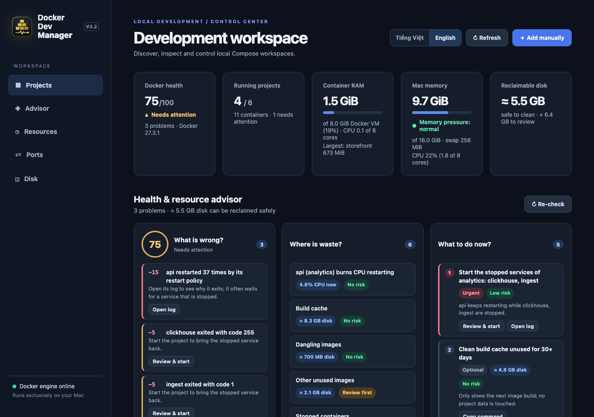
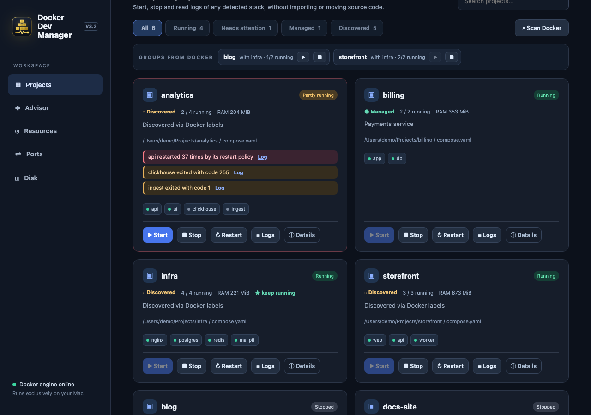
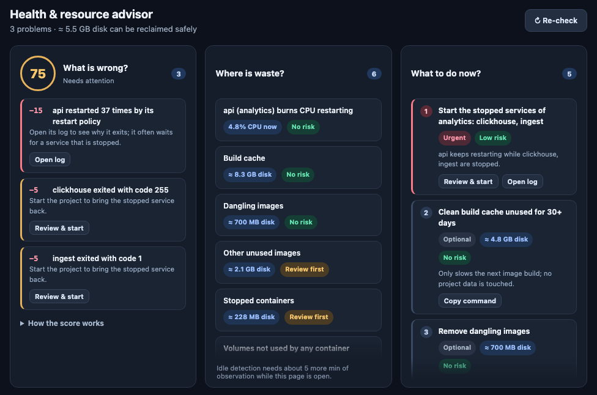
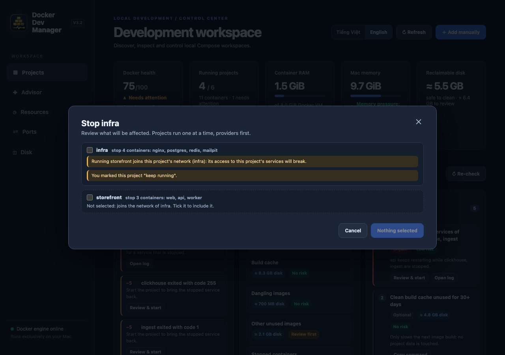
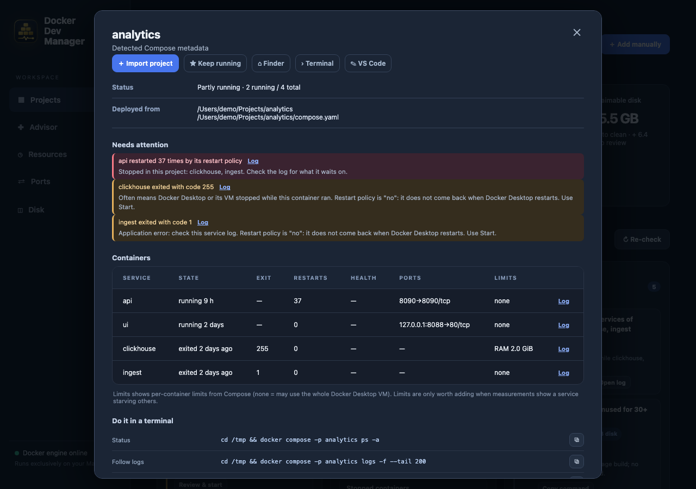
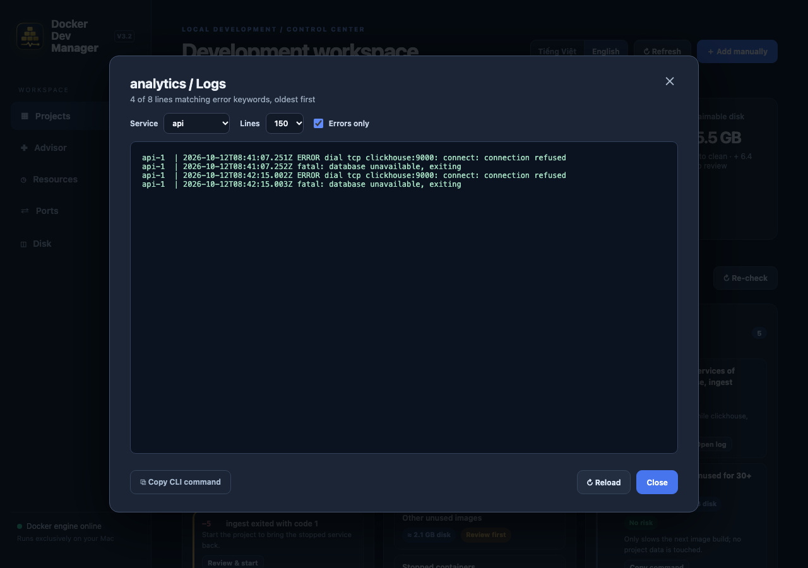
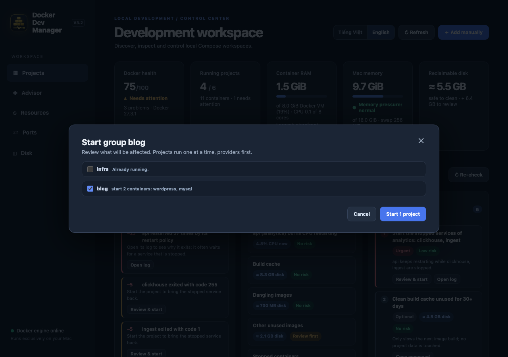
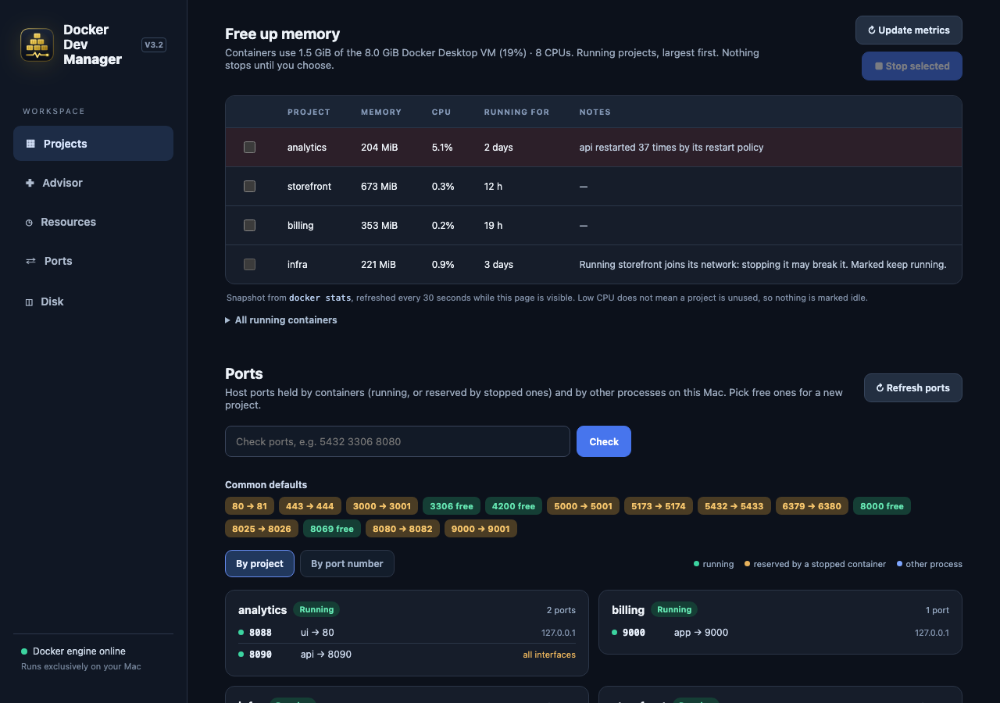
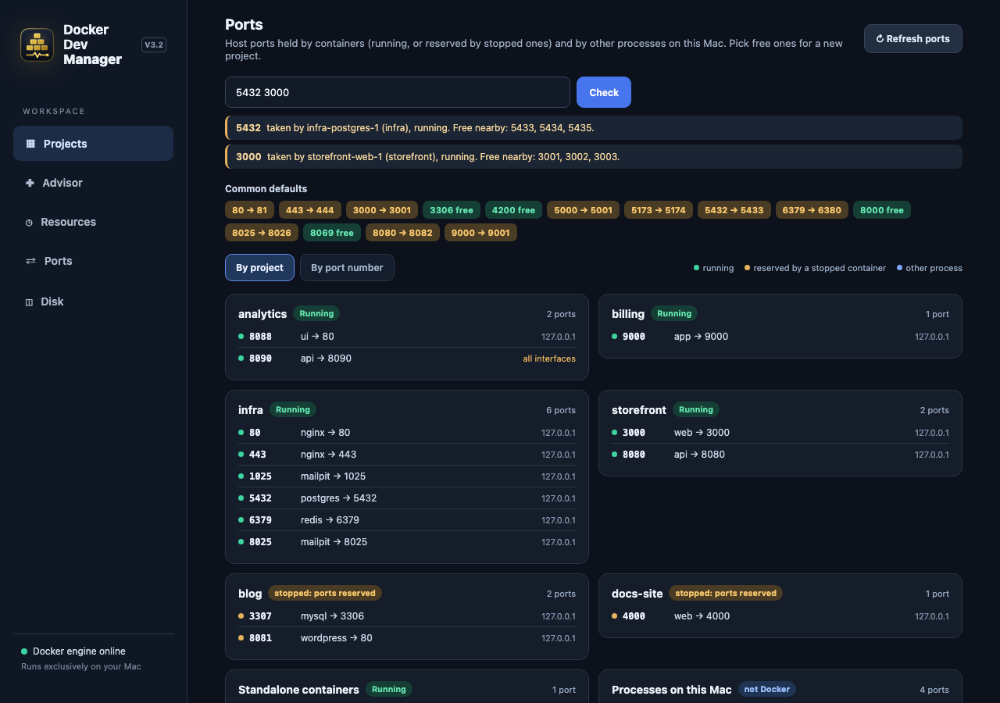
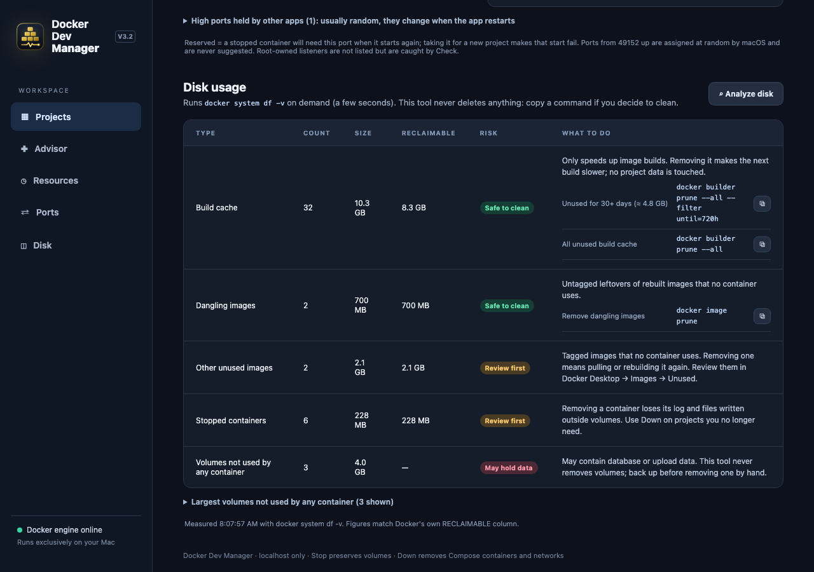

# Docker Dev Manager — User guide

**English** · [Tiếng Việt](guide.vi.md) · [Back to README](../README.md)

Docker Dev Manager is a local web page for the Docker Compose projects on your computer. It finds them automatically, starts and stops them, explains why one is not running, and helps you free memory, pick free ports and clean disk space safely.

> Screenshots use demo data.

## Contents

1. [Install and open](#1-install-and-open)
2. [The screen at a glance](#2-the-screen-at-a-glance)
3. [Health & resource advisor](#3-health--resource-advisor)
4. [Start, stop, restart](#4-start-stop-restart)
5. [Why is a project not running?](#5-why-is-a-project-not-running)
6. [Read logs](#6-read-logs)
7. [Groups from Docker](#7-groups-from-docker)
8. [Free up memory](#8-free-up-memory)
9. [Pick free ports](#9-pick-free-ports)
10. [Clean disk space safely](#10-clean-disk-space-safely)
11. [Import a project, Up and Down](#11-import-a-project-up-and-down)
12. [Language](#12-language)
13. [Questions and problems](#13-questions-and-problems)

## 1. Install and open

You need **Node.js 20+** and **Docker Desktop** (or Docker Engine with `docker compose` v2) running.

```bash
git clone https://github.com/atdevblog/docker-dev-manager.git
cd docker-dev-manager
npm start
```

There is nothing to install: the project has no npm dependencies. Open **http://localhost:4173**. Keep the terminal open while you use it; press `Ctrl+C` to stop. To use another port: `DEV_MANAGER_PORT=4174 npm start`.

## 2. The screen at a glance



- **Sidebar**: jump to Projects, Resources, Ports or Disk. The dot at the bottom shows whether Docker Engine is reachable.
- **Header**: switch language (*Tiếng Việt / English*), **Refresh**, and **Add manually** for a project that has no containers yet.
- **Overview cards** (click one to jump to the matching section):
  - *Docker health*: the advisor's score out of 100 with its status (Healthy, Needs attention, Unhealthy), the number of problems and the Docker version. It turns red when Docker Engine is unreachable.
  - *Running projects*: running out of total, with the number of containers and of projects that need attention.
  - *Container RAM*: memory used by containers against the Docker Desktop VM size (with a meter), CPU in cores, and the largest project.
  - *Mac memory*: memory used (counted like Activity Monitor) against the total, with a meter whose colour follows macOS memory pressure, plus swap and CPU. Heavy swap is highlighted when memory is short.
  - *Reclaimable disk*: what can be cleaned safely, plus what needs review first.
- **Filters**: All, Running, *Needs attention* (projects with problems), Managed, Discovered, plus a search box.
- **Health & resource advisor**: a health score, where resources are wasted and what to do now (see [section 3](#3-health--resource-advisor)).
- **Groups from Docker**: projects that belong together, detected automatically, with ▶ start and ■ stop (see [section 6](#7-groups-from-docker)).
- **Project cards**, one per Compose project found from Docker:
  - Status: *Running*, *Partly running*, *Stopped*.
  - *Discovered* means found automatically; *Managed* means you imported or added it (needed only for Up/Down).
  - `N sources` means the same project name was started from several folders or file sets.
  - ★ *keep running* marks shared infrastructure you never want to stop by accident.
  - Red or amber lines explain problems, each with a **Log** link.

Scroll down for the project cards:



Everything refreshes every 15 seconds while the page is visible.

## 3. Health & resource advisor



The advisor sits right under the overview cards and answers three questions. It refreshes every 30 seconds; **Re-check** updates it at once.

**What is wrong?** The health score starts at 100. Each problem deducts a fixed number of points, never an opaque number, and every line shows the cause, the fix and a button (open the log, review and start, details…). Hover a line for Docker's own explanation. 90–100 is *Healthy*, 70–89 *Needs attention*, below 70 *Unhealthy*. *How the score works* lists every rule:

| Problem | Points | Max |
|---|---|---|
| Docker Engine unreachable | −100 | |
| Crash loop | −15 each | −45 |
| Out of memory while running | −12 each | −36 |
| Unhealthy container / failed to start | −10 each | −30 each |
| Container at 90%+ of its own memory limit | −8 each | −24 |
| Port conflict (a stopped container cannot start) / missing network | −6 each | −18 each |
| Service down while the rest of its project runs | −5 each | −15 |
| Out of memory in the last run | −4 each | −12 |
| macOS memory pressure critical / warning | −20 / −8 | |
| Docker VM memory 90%+ used | −10 | |

**Where is waste?**
- *Idle projects*: running, but with no network traffic and CPU under 1% for at least 15 minutes. Low CPU alone never makes a project idle. The dashboard only measures while its page is open, so right after opening it tells you how many minutes it still needs.
- Containers burning CPU in a crash loop.
- Disk Docker could give back (build cache, dangling and unused images, stopped containers, unused volumes), each with its safety level.

**What to do now?** A ranked list, most serious first. Each action carries its level: **Urgent** (broken right now: crash loop, out of memory, failed start), **Important** (degraded service or memory pressure), **Recommended** (idle projects, past problems) and **Optional** (disk housekeeping). Each column keeps the same height and scrolls on its own, so the page does not jump when the advisor refreshes.
- Each action shows the estimated gain (≈ RAM or disk), a risk level and a button. Start and stop buttons open the usual review window; nothing runs without it.
- Idle projects are suggested together. A project they need (database, proxy) is added only when it is idle too and nothing else uses it. Under memory pressure (macOS warning or Docker VM 80%+), the largest projects are suggested as well, marked *Review first* because they are in use.
- Disk: safe categories come with a command to copy; images and volumes open the Disk section. Volumes are never removed automatically.
- **Keep running** lists the running projects that should stay, with the reason: marked keep running, used by another running project, in use, or not observed long enough yet.

To change the idle threshold: `DEV_MANAGER_IDLE_MINUTES=30 npm start`.

## 4. Start, stop, restart

Use the buttons on each card:

| Button | What it does | Your data |
|---|---|---|
| **▶ Start** | Starts the project's existing containers (`docker compose start`). Never recreates them. | Untouched |
| **■ Stop** | Stops the containers (`docker compose stop`). | Containers and volumes kept |
| **↻ Restart** | Restarts the containers. | Untouched |

Before every action the dashboard checks for problems. If everything is fine, it runs at once. If not, a review window opens:



- **Red** messages block the action because Docker would fail anyway, for example *"Port 5432 needed by db is taken by running container …"*. The message names the container to stop or the port to change.
- **Amber** messages are warnings you can accept. In the example, other projects use the network of `infra`, so stopping it would break them.
- Related projects appear **unticked**. Tick them if you want to include them; nothing outside your selection runs.
- A project that other running projects still use, or that you marked *keep running*, is also left **unticked**, as in the example. Stopping it has to be a deliberate choice.

## 5. Why is a project not running?

The card already lists the most important problems. Click **Details** for the full picture:



- **Needs attention** explains each problem in plain words:
  - *restarted N times*: a crash loop. The process keeps failing, often because a service it needs (database, cache) is stopped.
  - *exited with code N*: common codes are explained, such as 255 when Docker Desktop stopped, 137 when the container was killed, or 1 for an application error.
  - *OOM-killed*: the container ran out of memory.
  - *unhealthy* and *failed to start*: Docker's own reason is shown.
- **Containers** lists every service with its state, exit code, restart count, health, ports and limits, plus a **Log** link.
- **Needs / Used by** show links to other projects through shared Docker networks.
- **Do it in a terminal** lists the exact commands, ready to copy.
- **Finder / Terminal / VS Code** open the project folder (macOS).

Containers with restart policy `unless-stopped` or `always` that are stopped were stopped on purpose, so they are not reported as problems.

## 6. Read logs

Click **Logs** on a card, or **Log** next to a problem to open that service directly.



- Choose a **Service** or *All services*, and 150 or 500 **Lines**.
- **Errors only** keeps the lines that contain words such as *error*, *fatal*, *exception*, *refused*, *killed*.
- **Copy CLI command** copies the matching `docker compose … logs -f` command so you can follow the logs live in a terminal.

Log text is always shown exactly as Docker returns it.

## 7. Groups from Docker

Docker already groups containers into Compose projects; each card is one project. Groups go one level up: they put together the **projects that need each other**. You don't create them, because they come from Docker.

When a project's containers join a network created by another project (an `external` network in Compose, typically an app using a shared database or proxy stack), the dashboard forms a group named after the app. The group holds the app and every project it needs. In the screenshot, `blog` and `storefront` both use the network of `infra`, so there are two groups: *blog with infra* and *storefront with infra*. Projects that need nothing else get no group; their own card is enough.

1. Click **▶** on a group to start everything the app needs. A review always opens and lists every container that will be affected; projects already running are skipped:



2. Click **■** to stop the group. The shared project is left unticked if another running project still uses it.
3. Projects run one at a time; the projects others depend on start first and stop last. **Cancel remaining** stops before the next project.

Groups update by themselves when your Compose files change their networks.

## 8. Free up memory

Open **Resources** in the sidebar, or click the *Docker containers* card.



- Running projects are listed largest first, with memory, CPU and how long they have been running.
- **Notes** tell you what to watch out for, such as a crash loop, *"Running … join its network"* (stopping it breaks others), or *keep running*.
- Tick the projects you don't need right now and click **Stop N projects**. A review opens before anything stops.
- To protect shared infrastructure, open its **Details** and click **★ Keep running**. It can no longer be selected here.

Nothing is ever stopped automatically. Low CPU does not mean a project is unused, so the dashboard never calls it idle. **All running containers** shows the per-container figures.

## 9. Pick free ports

Open **Ports** before giving a new project its ports.



- **Check**: type one or more ports (for example `5432 3000`). You get *free*, or who holds the port and the nearest free alternatives.
- **Common defaults** shows at a glance which usual ports (80, 3000, 3306, 5432, 6379, 8080…) are taken and the next free one.
- **By project** groups ports per owner; **By port number** is a sorted table.
  - Green: a running container holds the port.
  - Amber, *reserved*: a **stopped** container will need this port when it starts again. Using it for a new project makes that start fail.
  - Blue: another program on your computer. On macOS, AirPlay Receiver uses 5000 and 7000.
  - *all interfaces* means other machines on your network can reach the port.

Ports from 49152 up are assigned at random by macOS and are never suggested.

## 10. Clean disk space safely

Open **Disk** and click **Analyze disk** (it takes a few seconds).



| Risk | Meaning |
|---|---|
| **Safe to clean** | Build cache and dangling images: only slows the next build. Copy the suggested command and run it in a terminal. |
| **Review first** | Unused tagged images (you would pull or rebuild them) and stopped containers (their logs are lost). |
| **May hold data** | Volumes not used by any container. They may contain databases, so they are only listed, with the project they came from. |

The dashboard never deletes anything itself.

## 11. Import a project, Up and Down

**Start**, **Stop**, **Restart** and **Logs** work for every project without importing it. You only need to import for:

- **Up**: create or recreate containers from the Compose file, for example after `Down` or after changing the file.
- **Down**: remove the project's containers and networks. Named volumes are kept.

To import, open **Details** and click **＋ Import project**. This is offered when Docker knows the project's single Compose file. Otherwise click **＋ Add manually** in the header and enter:

- the project name;
- the folder (absolute path);
- the Compose file name relative to that folder (for example `docker-compose.yml`).

Up always shows a review first, and checks the Compose file and ports. Down asks for confirmation.

## 12. Language

Use **Tiếng Việt / English** in the header. The page switches instantly and remembers your choice, even after a restart. Names of projects, containers, paths, ports and log content are never translated.

## 13. Questions and problems

| Problem | What to do |
|---|---|
| *Unable to connect to Docker Engine* | Start Docker Desktop and wait until it is running, then click **Refresh**. |
| A project is missing | Only projects that still have containers are found. Click **Scan Docker**, or **Add manually**. |
| Start is blocked | Read the red message: it names the container holding the port, or the missing network. |
| `N sources` badge | The project name was started from different folders or Compose file sets. Details lists each source, and Stop/Start act on all of them. |
| Port 4173 already in use | Run `DEV_MANAGER_PORT=4174 npm start`. |
| No CPU/RAM figures | Run `docker stats --no-stream` in a terminal to check Docker. |
