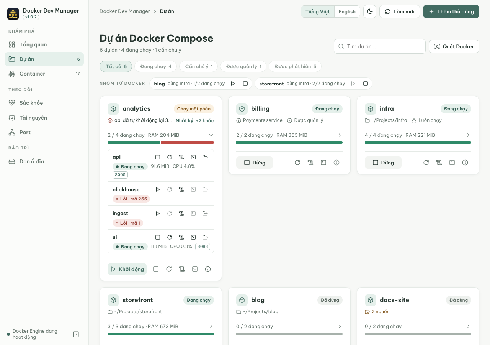
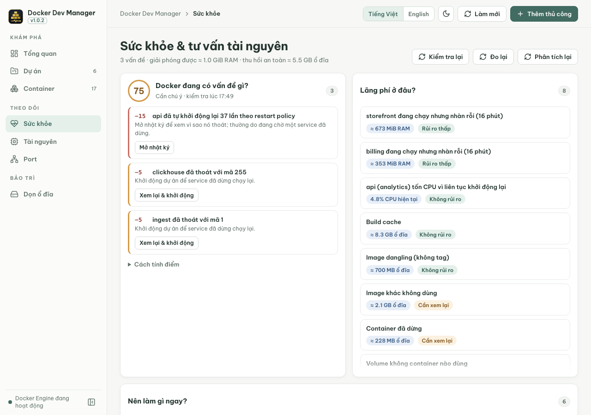
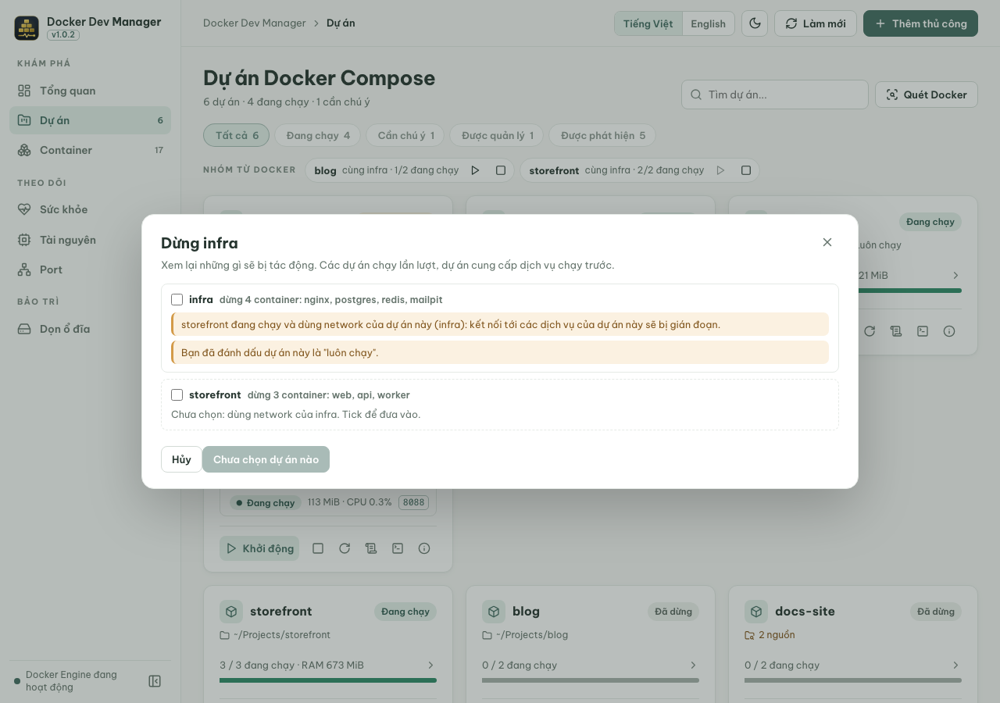
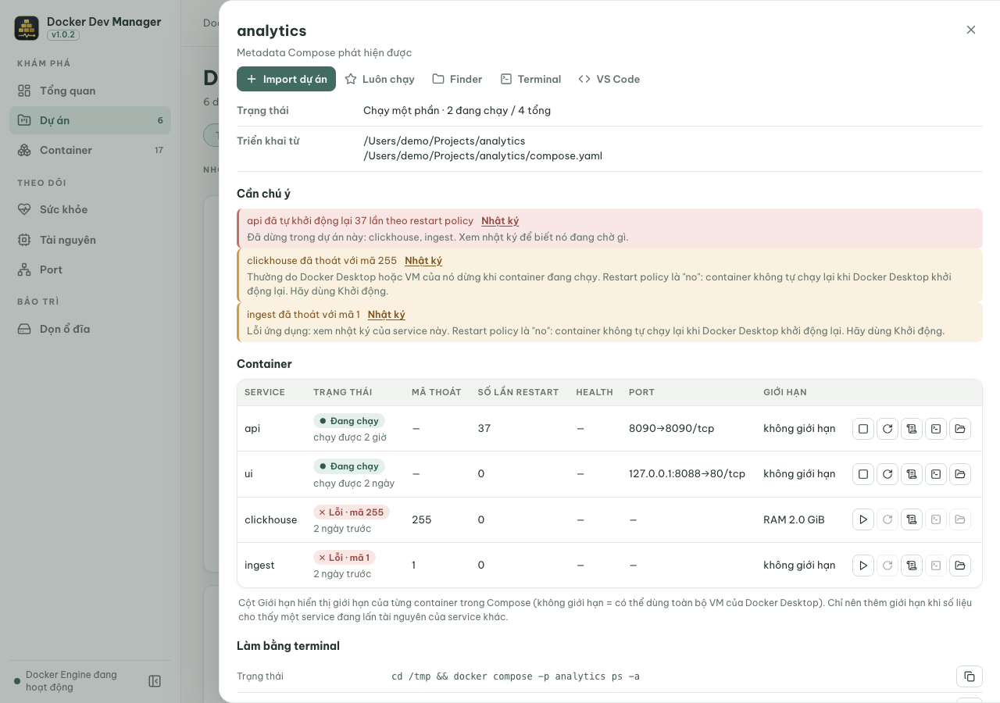
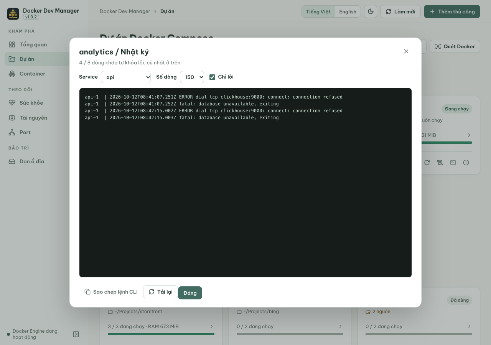
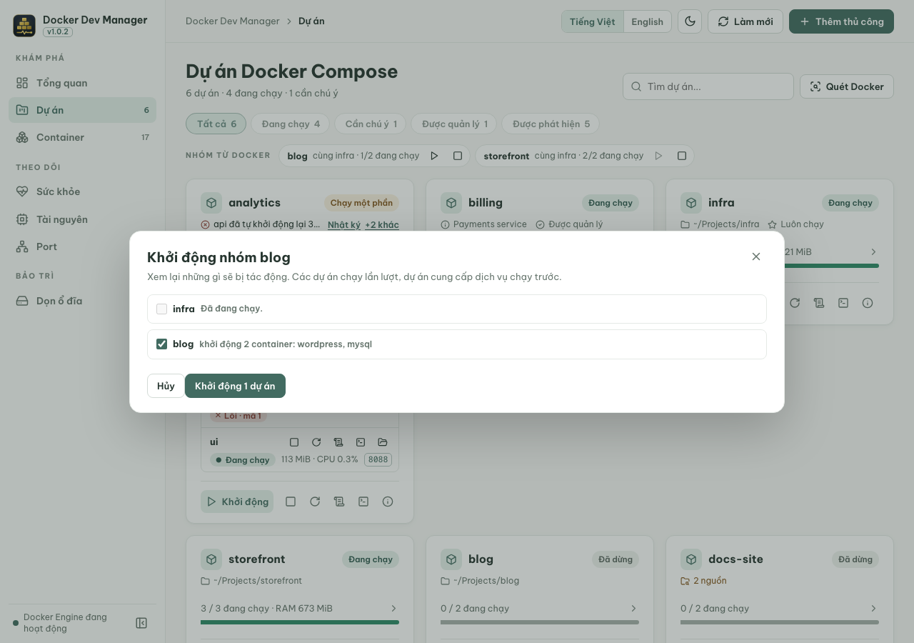
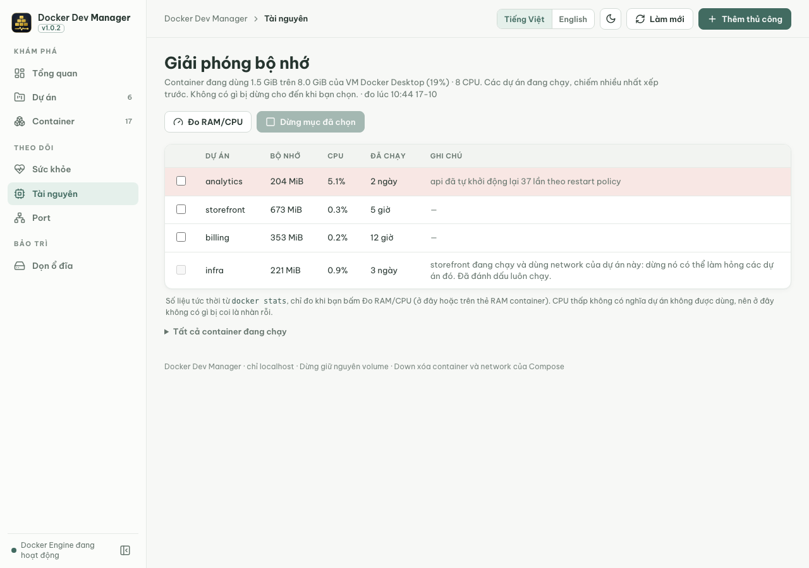
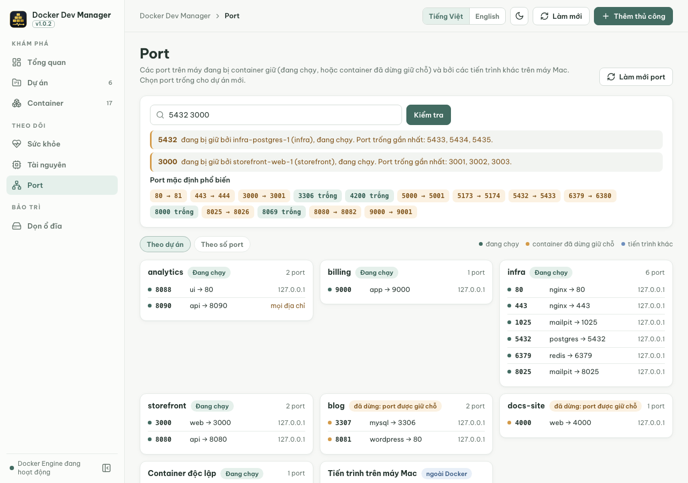
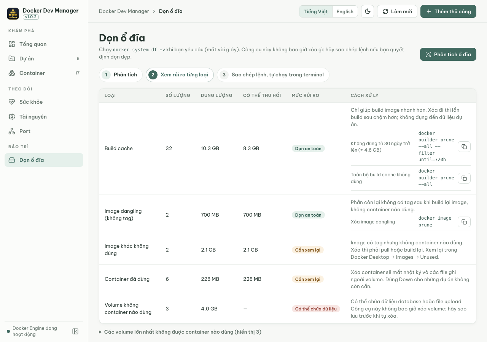

# Docker Dev Manager — Hướng dẫn sử dụng

[English](guide.en.md) · **Tiếng Việt** · [Về README](../README.vi.md)

Docker Dev Manager là một trang web chạy trên máy của bạn, dùng để quản lý các dự án Docker Compose trên máy. Nó tự tìm các dự án, khởi động và dừng chúng, giải thích vì sao một dự án không chạy, và giúp bạn giải phóng bộ nhớ, chọn port trống, dọn ổ đĩa an toàn.

> Ảnh chụp dùng dữ liệu demo.

## Mục lục

1. [Cài đặt và mở](#1-cài-đặt-và-mở)
2. [Tổng quan màn hình](#2-tổng-quan-màn-hình)
3. [Sức khỏe & tư vấn tài nguyên](#3-sức-khỏe--tư-vấn-tài-nguyên)
4. [Khởi động, dừng, khởi động lại](#4-khởi-động-dừng-khởi-động-lại)
5. [Vì sao dự án không chạy?](#5-vì-sao-dự-án-không-chạy)
6. [Xem nhật ký](#6-xem-nhật-ký)
7. [Nhóm từ Docker](#7-nhóm-từ-docker)
8. [Giải phóng bộ nhớ](#8-giải-phóng-bộ-nhớ)
9. [Chọn port trống](#9-chọn-port-trống)
10. [Dọn ổ đĩa an toàn](#10-dọn-ổ-đĩa-an-toàn)
11. [Import dự án, Up và Down](#11-import-dự-án-up-và-down)
12. [Ngôn ngữ](#12-ngôn-ngữ)
13. [Câu hỏi và sự cố thường gặp](#13-câu-hỏi-và-sự-cố-thường-gặp)

## 1. Cài đặt và mở

Cần có **Node.js 20+** và **Docker Desktop** (hoặc Docker Engine kèm `docker compose` v2) đang chạy.

```bash
git clone https://github.com/atdevblog/docker-dev-manager.git
cd docker-dev-manager
npm start
```

Không cần cài thêm gì vì dự án không có dependency npm nào. Mở **http://localhost:4173**. Giữ terminal mở trong lúc dùng, nhấn `Ctrl+C` để tắt. Muốn dùng port khác: `DEV_MANAGER_PORT=4174 npm start`.

## 2. Tổng quan màn hình


- **Thanh bên** chia ba nhóm, mỗi mục là một trang: *Khám phá* (**Tổng quan**, **Dự án**, **Container**), *Theo dõi* (**Sức khỏe**, **Tài nguyên**, **Port**) và *Bảo trì* (**Dọn ổ đĩa**). Chấm màu ở dưới cùng cho biết có kết nối được Docker Engine hay không, nút bên cạnh thu gọn thanh bên chỉ còn biểu tượng. Mỗi trang có địa chỉ riêng (`#projects`, `#containers`…), nên khi reload bạn vẫn ở đúng trang.
- **Thanh trên cùng:** bạn đang ở đâu, ngôn ngữ (*Tiếng Việt / English*), nút đổi giao diện sáng/tối, **Làm mới**, và **Thêm thủ công** cho dự án chưa có container. Giao diện theo macOS cho đến khi bạn chọn; lựa chọn được lưu cùng ngôn ngữ.
- **Tổng quan** cho biết chuyện gì đang diễn ra:
  - Năm thẻ (bấm vào thẻ để mở trang của nó):
    - *Sức khỏe Docker*: điểm trên 100 kèm trạng thái (Khỏe, Cần chú ý, Không ổn), số vấn đề và thời điểm kiểm tra. Thẻ ghi *Chưa kiểm tra* cho đến khi bạn bấm **Kiểm tra** trên thẻ (khoảng nửa giây). Thẻ chuyển đỏ khi mất kết nối Docker Engine.
    - *Dự án đang chạy*: số đang chạy trên tổng số, kèm số container và số dự án cần chú ý.
    - *RAM container*: RAM container đang dùng so với dung lượng VM của Docker Desktop (có thanh đo), CPU tính theo nhân, và dự án ngốn nhiều nhất. Thẻ cần `docker stats` (tốn khoảng 2 giây xử lý của Docker), nên ghi *Chưa đo* cho đến khi bạn bấm **Đo** trên thẻ.
    - *Bộ nhớ máy Mac*: bộ nhớ đã dùng (tính như Activity Monitor) trên tổng, thanh đo đổi màu theo áp lực bộ nhớ của macOS, kèm swap và CPU. Swap lớn được làm nổi bật khi máy thiếu bộ nhớ.
    - *Ổ đĩa thu hồi được*: phần dọn được an toàn, cộng phần cần xem lại trước. Bấm **Phân tích** trên thẻ (`docker system df -v`, mất vài giây).
  - **Container theo dự án:** mỗi dự án một thanh, dài theo số container và chia màu theo trạng thái (đang chạy, không khỏe hoặc tạm dừng, lỗi hoặc khởi động lại, đã dừng), cuối thanh ghi *đang chạy / tổng*. Rê chuột lên thanh để xem số lượng, bấm vào tên để xem chi tiết, **Xem bảng** mở trang Container.
  - **RAM theo dự án:** các dự án xếp theo bộ nhớ, kèm tỷ lệ trên VM Docker, lấy từ lần đo *RAM container* gần nhất. Container không thuộc dự án nào được gộp thành *Container độc lập*.
  - **Cần chú ý:** các vấn đề mà dự án đang báo, lỗi xếp trước, mỗi dòng kèm tên dự án và nút **Nhật ký**.
  - **Dự án:** các dự án đầu danh sách cùng trạng thái và RAM; bấm vào tên để xem chi tiết, **Xem tất cả** để xem hết. Mọi khối đều thu gọn được bằng cách bấm tiêu đề, lựa chọn được ghi nhớ.
- **Dự án:** bộ lọc (Tất cả, Đang chạy, *Cần chú ý*, Được quản lý, Được phát hiện), ô tìm kiếm, các [nhóm từ Docker](#7-nhóm-từ-docker) với nút ▶ khởi động và ■ dừng, và mỗi dự án Compose là một card:
  - Bấm vào **tên dự án** để mở phần chi tiết, hiện thành một ngăn trượt từ bên phải. Rê chuột lên tên để biết dự án *Được phát hiện* (tự tìm thấy) hay *Được quản lý* (bạn đã import hoặc thêm thủ công, chỉ cần cho Up/Down), cùng thư mục của nó.
  - Trạng thái: *Đang chạy*, *Chạy một phần* hoặc *Đã dừng*.
  - Một dòng dưới tên cho biết điều đáng biết nhất: vấn đề nghiêm trọng nhất (kèm **Nhật ký** và **+N khác**), nếu không có thì mô tả, nếu không nữa thì thư mục. Theo sau là các nhãn: *Được quản lý*, `N nguồn` (cùng một tên dự án được chạy từ nhiều thư mục hoặc bộ file khác nhau) và ★ *Luôn chạy* (hạ tầng dùng chung mà bạn không muốn lỡ tay dừng).
  - **Thanh container** ghi *đang chạy / tổng*, RAM sau khi đã đo, và tô màu trạng thái của từng container; rê chuột lên để xem số lượng.
  - Các nút: bước tiếp theo bằng chữ (**▶ Khởi động**, hoặc **■ Dừng** khi mọi thứ đang chạy), sau đó là các icon nhẹ có tooltip cho Dừng, Khởi động lại, Nhật ký, Terminal và Chi tiết, chỉ hiện khi bấm được.



Bấm vào **thanh container** trên card để mở ra từng container với nút riêng (xem [Điều khiển từng container](#điều-khiển-từng-container)).

- **Container:** mọi container của mọi dự án trong một bảng, gồm trạng thái, CPU · RAM (sau khi đã đo), port, thời gian chạy và các nút giống trên card. Lọc theo Đang chạy, Đã dừng hoặc Có vấn đề, hoặc tìm theo tên, dự án, image hay port. Container có vấn đề xếp lên đầu.

Danh sách dự án và *Bộ nhớ máy Mac* tự làm mới mỗi 15 giây khi trang đang mở, vì rất nhẹ. Các phép đo chỉ chạy khi bạn bấm nút của nó, trên thẻ ở trang Tổng quan hoặc ở đầu trang tương ứng, mỗi lần một phép, để dashboard luôn nhẹ. Đo xong, nút đổi thành **↻ Kiểm tra lại**, **↻ Đo lại** hoặc **↻ Phân tích lại**, và thẻ ghi rõ đo lúc mấy giờ. Kết quả đo được ghi nhớ: sau khi reload (hay khởi động lại) chúng hiện lại kèm giờ đo. Chỉ phần kiểm tra sức khỏe tự chạy lại vì chỉ mất nửa giây; RAM/CPU và ổ đĩa chờ bạn bấm.

## 3. Sức khỏe & tư vấn tài nguyên



Trang **Sức khỏe** trả lời ba câu hỏi từ những gì bạn đã đo. Đầu trang có ba nút giống trên các thẻ của trang Tổng quan:

- **Kiểm tra** trên thẻ *Sức khỏe Docker* điền cột *Docker đang có vấn đề gì?*
- **Đo** trên thẻ *RAM container* (`docker stats`) và **Phân tích** trên thẻ *Ổ đĩa thu hồi được* (`docker system df -v`) điền cột *Lãng phí ở đâu?*. Kết quả này cũng điền mục [Giải phóng bộ nhớ](#8-giải-phóng-bộ-nhớ) và mục [Ổ đĩa](#10-dọn-ổ-đĩa-an-toàn).
- *Nên làm gì ngay?* tổng hợp từ những gì đã đo, và ghi rõ phần nào chưa xét.

Sau khi bạn khởi động hay dừng gì đó, dòng tóm tắt báo số liệu đã cũ; bấm ↻ để cập nhật.

**Docker đang có vấn đề gì?** Điểm sức khỏe bắt đầu từ 100. Mỗi vấn đề trừ một số điểm cố định, không phải con số tùy ý, và mỗi dòng cho biết nguyên nhân, cách xử lý cùng một nút (mở nhật ký, xem lại & khởi động, chi tiết…). Rê chuột lên dòng để xem giải thích gốc của Docker. 90–100 là *Khỏe*, 70–89 *Cần chú ý*, dưới 70 *Không ổn*. Mục *Cách tính điểm* liệt kê mọi luật:

| Vấn đề | Điểm | Tối đa |
|---|---|---|
| Không kết nối được Docker Engine | −100 | |
| Crash loop | −15 mỗi lỗi | −45 |
| Hết bộ nhớ khi đang chạy | −12 mỗi lỗi | −36 |
| Container unhealthy / khởi động thất bại | −10 mỗi lỗi | −30 mỗi loại |
| Container dùng từ 90% giới hạn RAM của chính nó | −8 mỗi lỗi | −24 |
| Xung đột port (container đã dừng không khởi động được) / mất network | −6 mỗi lỗi | −18 mỗi loại |
| Service dừng trong khi phần còn lại của dự án vẫn chạy | −5 mỗi lỗi | −15 |
| Hết bộ nhớ ở lần chạy trước | −4 mỗi lỗi | −12 |
| Áp lực bộ nhớ macOS nghiêm trọng / cảnh báo | −20 / −8 | |
| VM Docker dùng từ 90% RAM | −10 | |

**Lãng phí ở đâu?**
- *Dự án nhàn rỗi*: đang chạy nhưng không có traffic mạng và CPU dưới 1% giữa hai lần đo RAM/CPU cách nhau ít nhất 15 phút. CPU thấp thôi không bao giờ đủ để coi là nhàn rỗi. Sau lần đo đầu, mục tư vấn sẽ cho biết khi nào nên đo lại.
- Container tốn CPU vì crash loop.
- Ổ đĩa Docker có thể trả lại (build cache, image dangling và image không dùng, container đã dừng, volume không dùng), mỗi loại kèm mức độ an toàn.

**Nên làm gì ngay?** Danh sách xếp theo mức nghiêm trọng, việc gấp nhất ở trên cùng. Mỗi việc có nhãn mức độ: **Khẩn cấp** (đang hỏng: crash loop, hết bộ nhớ, khởi động thất bại), **Quan trọng** (dịch vụ chập chờn hoặc máy thiếu bộ nhớ), **Nên làm** (dự án nhàn rỗi, sự cố đã qua) và **Tối ưu** (dọn ổ đĩa). Ba cột luôn cao bằng nhau và tự cuộn bên trong, nên trang không bị giật.
- Mỗi việc có ước tính lợi ích (≈ RAM hoặc ổ đĩa), mức rủi ro và một nút. Nút khởi động và dừng luôn mở cửa sổ xem lại như thường lệ; không có gì chạy mà không qua bước này.
- Các dự án nhàn rỗi được gợi ý dừng cùng nhau. Dự án mà chúng cần (database, proxy) chỉ được thêm vào khi nó cũng nhàn rỗi và không dự án nào khác dùng. Khi máy thiếu bộ nhớ (macOS cảnh báo hoặc VM Docker từ 80%), các dự án lớn nhất cũng được gợi ý, kèm nhãn *Cần xem lại* vì chúng đang được dùng.
- Ổ đĩa: các loại an toàn có sẵn lệnh để sao chép; image và volume mở mục Ổ đĩa. Volume không bao giờ bị xóa tự động.
- **Nên giữ chạy** liệt kê các dự án đang chạy nên giữ lại, kèm lý do: đã đánh dấu luôn chạy, đang được dự án khác dùng, đang được dùng, hoặc chưa đo đủ lâu.

Muốn đổi ngưỡng nhàn rỗi: `DEV_MANAGER_IDLE_MINUTES=30 npm start`.

## 4. Khởi động, dừng, khởi động lại

Dùng các nút trên mỗi card: bước tiếp theo hiện bằng chữ, các nút còn lại là icon (rê chuột để xem tên).

| Nút | Tác dụng | Dữ liệu của bạn |
|---|---|---|
| **▶ Khởi động** | Chạy lại các container sẵn có của dự án (`docker compose start`). Không bao giờ tạo lại container. | Giữ nguyên |
| **■ Dừng** | Dừng các container (`docker compose stop`). | Giữ container và volume |
| **↻ Khởi động lại** | Khởi động lại các container. | Giữ nguyên |
| **Terminal** | Mở Terminal tại thư mục dự án (nơi có file Compose). | Giữ nguyên |

Trước mỗi thao tác, dashboard đều kiểm tra trước. Nếu không có vấn đề, thao tác chạy ngay. Nếu có, một cửa sổ xem lại sẽ mở ra:



- Thông báo **đỏ** chặn thao tác, vì Docker chắc chắn sẽ lỗi. Ví dụ *"Port 5432 mà db cần đang bị container … chiếm"*: thông báo nêu rõ container cần dừng hoặc port cần đổi.
- Thông báo **vàng** là cảnh báo, bạn có thể chấp nhận. Trong ví dụ, dự án khác đang dùng network của `infra`, nên dừng `infra` sẽ làm chúng gián đoạn.
- Các dự án liên quan hiện ở trạng thái **chưa tick**. Tick vào nếu muốn đưa vào; mặc định không có gì ngoài lựa chọn của bạn được chạy.
- Dự án mà dự án khác đang chạy vẫn còn dùng, hoặc được bạn đánh dấu *luôn chạy*, cũng **không được tick sẵn**, như trong ví dụ. Muốn dừng nó, bạn phải tự chọn.

### Điều khiển từng container

Giống Docker Desktop, mỗi container có thể điều khiển riêng. Trên card, bấm vào **thanh container** (hoặc mở **Chi tiết**). Mỗi container là một dòng gồm tên, bên dưới là trạng thái, RAM và CPU (sau khi đã đo) và các port trên máy (bấm vào để mở trong trình duyệt), cùng các nút: **▶ Khởi động** hoặc **■ Dừng**, **↻ Khởi động lại**, **Nhật ký**, và hai nút Terminal:

- Icon **terminal** mở Terminal với shell bên trong container (`docker exec`, dùng bash nếu có), vào sẵn thư mục làm việc của nó, ví dụ `/var/www/api`. Chỉ dùng được khi container đang chạy.
- Icon **thư mục** mở Terminal trên máy Mac tại thư mục mã nguồn của container, tức thư mục được gắn vào thư mục làm việc của nó, ví dụ `~/Projects/api`. Nút mờ khi mã nằm trong image hoặc volume.


- Mỗi trạng thái có màu, biểu tượng và chữ riêng trên dòng container, và cùng màu đó trên thanh container của card: **● Đang chạy** (xanh lá), **‖ Tạm dừng** (vàng), **■ Đã dừng** (xám), **✕ Lỗi** kèm mã thoát hoặc *Hết bộ nhớ* (đỏ), **↻ Đang khởi động lại** (đỏ, crash loop), **◐ Đang khởi động** và **○ Mới tạo** (xanh dương). Dừng với mã thông thường (0, 137, 143) được tính là đã dừng, không phải lỗi.
- Các nút chạy `docker start`, `docker stop` hoặc `docker restart` trên đúng container đó. Các container khác vẫn chạy bình thường, và khởi động lại không kéo theo các service mà nó phụ thuộc.
- Vẫn có bước kiểm tra trước. Dừng một container mà container khác cần (`depends_on`), hoặc gắn vào network mà dự án khác đang chạy dùng, hoặc thuộc dự án *luôn chạy*, sẽ mở cửa sổ xem lại trước, ví dụ *"app, worker phụ thuộc mariadb: vẫn chạy tiếp nhưng có thể lỗi cho đến khi mariadb chạy lại."*
- Khởi động một container sẽ bị chặn khi port của nó đã bị chiếm hoặc network không còn, và có cảnh báo khi service nó phụ thuộc đang dừng.

## 5. Vì sao dự án không chạy?

Card hiện vấn đề nghiêm trọng nhất ngay dưới tên dự án. Bấm vào tên để xem đầy đủ:



- **Cần chú ý** giải thích từng vấn đề bằng lời dễ hiểu:
  - *tự khởi động lại N lần*: crash loop. Tiến trình liên tục lỗi, thường vì một dịch vụ nó cần (database, cache) đang dừng.
  - *đã thoát với mã N*: các mã phổ biến đều được giải thích, ví dụ 255 khi Docker Desktop dừng, 137 khi container bị kill, 1 khi ứng dụng lỗi.
  - *bị kill vì hết bộ nhớ (OOM)*: container hết bộ nhớ.
  - *unhealthy* và *khởi động thất bại*: hiển thị lý do gốc của Docker.
- **Container** liệt kê từng service với trạng thái, mã thoát, số lần restart, health, port, giới hạn tài nguyên, kèm liên kết **Nhật ký**.
- **Phụ thuộc / Được dùng bởi** cho biết liên kết với dự án khác qua network Docker dùng chung.
- **Làm bằng terminal** có sẵn đúng các lệnh để sao chép.
- **Finder / Terminal / VS Code** mở thư mục dự án (macOS).

Container có restart policy `unless-stopped` hoặc `always` mà đang dừng thì đã được dừng có chủ đích, nên không bị báo là vấn đề.

## 6. Xem nhật ký

Bấm icon **Nhật ký** trên card, hoặc **Nhật ký** bên cạnh một vấn đề để mở thẳng đúng service đó.



- Chọn **Service** hoặc *Tất cả service*, và 150 hoặc 500 **Số dòng**.
- **Chỉ lỗi** giữ lại các dòng chứa từ như *error*, *fatal*, *exception*, *refused*, *killed*.
- **Sao chép lệnh CLI** sao chép lệnh `docker compose … logs -f` tương ứng để theo dõi trực tiếp trong terminal.

Nội dung nhật ký luôn được hiển thị đúng như Docker trả về.

## 7. Nhóm từ Docker

Docker đã gom container thành dự án Compose; mỗi card là một dự án. Nhóm ở cấp cao hơn: gom các **dự án cần nhau**. Bạn không cần tạo nhóm, vì nhóm lấy từ Docker.

Khi container của một dự án dùng network do dự án khác tạo (`external` network trong Compose), thường là ứng dụng dùng chung stack database hoặc proxy, dashboard tự tạo một nhóm mang tên ứng dụng đó. Nhóm gồm ứng dụng và mọi dự án nó cần. Trong ảnh, `blog` và `storefront` đều dùng network của `infra`, nên có hai nhóm: *blog cùng infra* và *storefront cùng infra*. Dự án không cần dự án nào khác thì không có nhóm; card của chính nó là đủ.

1. Bấm **▶** trên nhóm để khởi động mọi thứ ứng dụng cần. Luôn có cửa sổ xem lại liệt kê từng container sẽ bị tác động; dự án đã chạy sẵn được bỏ qua:



2. Bấm **■** để dừng nhóm. Dự án dùng chung sẽ không được tick nếu dự án khác đang chạy vẫn còn dùng nó.
3. Các dự án chạy lần lượt; dự án mà dự án khác phụ thuộc vào sẽ khởi động trước và dừng sau cùng. **Hủy phần còn lại** dừng trước khi sang dự án kế tiếp.

Nhóm tự cập nhật khi file Compose của bạn thay đổi network.

## 8. Giải phóng bộ nhớ

Mở **Tài nguyên** ở thanh bên, hoặc bấm vào thẻ *RAM container*. Bấm **Đo RAM/CPU** ở đây hoặc **Đo** trên thẻ *RAM container* (`docker stats`, khoảng 2 giây). Số liệu là ảnh chụp tại thời điểm đo, dự án đã dừng sau đó sẽ tự rời khỏi danh sách.



- Các dự án đang chạy được liệt kê theo mức chiếm bộ nhớ giảm dần, kèm bộ nhớ, CPU và thời gian đã chạy.
- **Ghi chú** cho biết điều cần lưu ý: crash loop, *"… đang chạy và dùng network của dự án này"* (dừng nó sẽ làm hỏng dự án khác), hoặc *luôn chạy*.
- Tick những dự án chưa cần dùng rồi bấm **Dừng N dự án**. Cửa sổ xem lại sẽ mở trước khi dừng bất cứ thứ gì.
- Để bảo vệ hạ tầng dùng chung, mở **Chi tiết** của nó và bấm **★ Luôn chạy**. Dự án đó sẽ không còn chọn được ở đây.

Không có gì bị dừng tự động. CPU thấp không có nghĩa là dự án không được dùng, nên dashboard không bao giờ gọi nó là nhàn rỗi. **Tất cả container đang chạy** hiển thị số liệu theo từng container.

## 9. Chọn port trống

Mở **Port** trước khi gán port cho dự án mới.



- **Kiểm tra:** nhập một hoặc nhiều port (ví dụ `5432 3000`). Kết quả cho biết port *trống*, hoặc ai đang giữ nó kèm các port trống gần nhất.
- **Port mặc định phổ biến** cho thấy ngay các port quen thuộc (80, 3000, 3306, 5432, 6379, 8080…) đã bị chiếm chưa và port trống kế tiếp.
- **Theo dự án** gom port theo chủ sở hữu; **Theo số port** là bảng sắp xếp theo số.
  - Xanh lá: container đang chạy giữ port.
  - Vàng, *giữ chỗ*: một container **đã dừng** sẽ cần port này khi khởi động lại. Dùng port này cho dự án mới sẽ khiến lần khởi động đó thất bại.
  - Xanh dương: chương trình khác trên máy. Trên macOS, AirPlay Receiver dùng port 5000 và 7000.
  - *mọi địa chỉ* nghĩa là máy khác trong mạng LAN có thể truy cập port đó.

Port từ 49152 trở lên do macOS cấp ngẫu nhiên nên không bao giờ được gợi ý.

## 10. Dọn ổ đĩa an toàn

Mở **Dọn ổ đĩa** và bấm **Phân tích ổ đĩa** (mất vài giây); nút **Phân tích** trên thẻ *Ổ đĩa thu hồi được* cũng làm việc tương tự. Ba bước chỉ đường: phân tích, xem rủi ro từng loại, rồi sao chép lệnh và tự chạy.



| Mức rủi ro | Ý nghĩa |
|---|---|
| **Dọn an toàn** | Build cache và image dangling: chỉ làm lần build sau chậm hơn. Sao chép lệnh gợi ý và chạy trong terminal. |
| **Cần xem lại** | Image có tag nhưng không dùng (phải pull hoặc build lại) và container đã dừng (mất nhật ký của chúng). |
| **Có thể chứa dữ liệu** | Volume không container nào dùng. Có thể chứa database nên chỉ được liệt kê, kèm dự án đã tạo ra nó. |

Dashboard không bao giờ tự xóa bất cứ thứ gì.

## 11. Import dự án, Up và Down

**Khởi động**, **Dừng**, **Khởi động lại** và **Nhật ký** dùng được cho mọi dự án mà không cần import. Bạn chỉ cần import để dùng:

- **Up:** tạo hoặc tạo lại container từ file Compose, ví dụ sau khi `Down` hoặc sau khi sửa file.
- **Down:** xóa container và network của dự án. Volume có tên được giữ lại.

Để import, mở **Chi tiết** và bấm **＋ Import dự án**. Nút này xuất hiện khi Docker biết chính xác một file Compose duy nhất của dự án. Nếu không có nút này, bấm **＋ Thêm thủ công** trên header và nhập:

- tên dự án;
- thư mục (đường dẫn tuyệt đối);
- tên file Compose, tương đối so với thư mục (ví dụ `docker-compose.yml`).

Nút **Chọn…** cạnh ô thư mục mở cửa sổ Finder: chọn thư mục là dashboard tự điền đường dẫn, file Compose tìm thấy trong đó và, nếu đang trống, tên dự án. Ô mô tả nhận tới 240 ký tự, viết được nhiều dòng.

Up luôn hiện cửa sổ xem lại trước, và kiểm tra file Compose cùng port. Down luôn yêu cầu xác nhận.

## 12. Ngôn ngữ

Dùng nút **Tiếng Việt / English** trên header. Trang chuyển ngay và ghi nhớ lựa chọn trong file cài đặt, nên vẫn giữ sau khi reload hay khởi động lại, và trên mọi địa chỉ bạn dùng để mở dashboard (localhost hoặc tên miền cục bộ). Tên dự án, container, đường dẫn, port và nội dung nhật ký không bao giờ bị dịch.

## 13. Câu hỏi và sự cố thường gặp

| Vấn đề | Cách xử lý |
|---|---|
| *Không thể kết nối Docker Engine* | Mở Docker Desktop, chờ chạy xong rồi bấm **Làm mới**. |
| Thiếu một dự án | Chỉ tìm được dự án còn container. Bấm **Quét Docker**, hoặc **Thêm thủ công**. |
| Khởi động bị chặn | Đọc thông báo đỏ: nó nêu container đang giữ port hoặc network bị thiếu. |
| Badge `N nguồn` | Tên dự án được chạy từ các thư mục hoặc bộ file Compose khác nhau. Chi tiết liệt kê từng nguồn; Khởi động/Dừng tác động lên tất cả. |
| Port 4173 đã bị dùng | Chạy `DEV_MANAGER_PORT=4174 npm start`. |
| Không có số liệu CPU/RAM | Số liệu chỉ đo khi bạn yêu cầu: bấm **Đo** trên thẻ *RAM container*. Nếu vẫn trống, chạy `docker stats --no-stream` trong terminal để kiểm tra Docker. |
